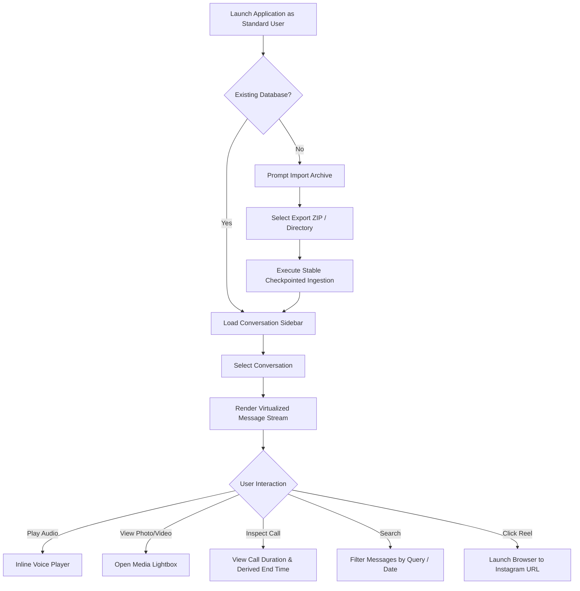

# Product Requirements Document (PRD)
## Instagram Chat History Viewer (Windows Desktop)

**Document Version:** 1.1.0  
**Status:** Approved Baseline (Post-Audit Revision)  
**Target Release:** MVP (Phase 1)  
**Author:** Senior Product Architect & Engineering Planning Agent  

---

## 1. Product Vision and Goals

### 1.1 Problem Statement
Users who rely on Instagram Direct Messaging (DM) for personal, family, and professional communication face significant challenges when reviewing, searching, or archiving their conversations on a desktop computer:
1. **Ephemeral or Fragmented Web Experience:** The Instagram web interface is designed primarily for transient interactions, lacking offline access, robust message search, advanced filtering, or reliable long-term historical browsing.
2. **Media Decay and Inaccessible Audio:** Critical communications—especially voice notes, shared images, and video clips—can become inaccessible, difficult to retrieve sequentially, or lost when chats grow long.
3. **Data Export Opacity:** While Meta provides official "Download Your Information" (DYI) archives (in JSON or HTML format), these raw data packages consist of disjointed JSON files and unindexed media folders. Non-technical users cannot easily read, play, or navigate them as a cohesive conversation thread.
4. **Privacy Concerns:** Third-party cloud archiving services require users to share their Instagram credentials, session tokens, or private conversation dumps with external servers, posing unacceptable security and privacy risks.

### 1.2 Target User & Data Source Boundaries
- **Archive Enthusiasts & Personal Curators (Primary Target):** Individuals who want to safeguard personal voice notes, photos, and messages exchanged with close friends or family.  
  *Source Boundary:* These users hold personal Instagram accounts. Meta provides **NO public live API** for personal accounts. Their sole legitimate data ingestion mechanism is official Meta DYI export archives (`.zip` or uncompressed directories). Incremental updates occur via file-diff ingestion of newer exports.
- **Freelancers & Small Business Owners (Secondary Target):** Creators and professionals with Instagram Business or Creator accounts linked to a verified Facebook Page.  
  *Source Boundary:* Eligible for official Meta Graph API messaging endpoints, but subject to strict Meta App Review, Graph API rate limits, temporary CDN media URLs, and the requirement of external webhook relay infrastructure (which is explicitly excluded from the local desktop MVP).
- **Privacy-Conscious Desktop Users:** Users running Windows 10/11 who require lightweight, local-first applications that operate strictly on their local machine without remote telemetry, external proxies, or cloud databases.

### 1.3 Intended Experience
The application delivers a lightweight, responsive Windows desktop dashboard that visually mirrors Instagram's modern direct messaging interface:
- A clean conversation sidebar displaying avatars, participant handles/names, unread/read states, and snippet previews.
- A central chronological message stream featuring familiar message bubbles (incoming on the left, outgoing on the right), with accurate sender attribution.
- Integrated media components:
  - **Inline voice message players** with waveform/progress bars, play/pause controls, and duration indicators.
  - Image thumbnails with full-resolution preview lightbox.
  - Inline video player with playback controls.
  - Reaction badges pinned to message bubbles.
  - Quoted reply headers linking to the parent message (where supported by source metadata).
  - Formatted "Shared Reel / Post" link cards.
  - Distinct timeline badges for voice and video call events.
- Instant search and date/attachment filters.
- Seamless recovery from interrupted imports and zero-configuration offline availability.

### 1.4 Primary Goals
1. **Local-First Preservation:** Store all imported conversation threads, participant metadata, timestamps, and media files locally in a structured database (SQLite) without external server dependencies.
2. **Accurate Audio/Visual Playback:** Provide reliable, inline playback of voice notes and video attachments, treating voice messages as a top-tier functional priority.
3. **Data Integrity & Traceability:** Preserve original timestamps, sender attribution, reaction records, and call logs exactly as delivered by the authorized source, avoiding synthetic or fabricated data.
4. **Resilient Synchronization & Ingestion:** Support bulk historical import from official Meta data exports across diverse folder structures, utilizing durable checkpoints to ensure crash recovery and eliminate duplicate records while preserving legitimate identical messages.
5. **Lightweight Windows Footprint:** Maintain minimal memory and CPU usage, fast startup, optional Windows logon startup, and full compliance with standard Windows desktop conventions without requiring administrative elevation.

### 1.5 Definition of MVP Success
The MVP is considered successful when a user can:
1. Launch the application on standard Windows 10/11 hardware as an unprivileged user without administrative elevation prompts.
2. Import an official Instagram data archive folder/ZIP (tested with archives containing 100,000+ messages across multiple conversations).
3. Browse conversations smoothly with correct chronological ordering and participant attribution.
4. Play any preserved voice message inline with seeking and accurate duration display.
5. Inspect reactions, call records, shared Reels/posts, and source-available metadata with explicit handling of unavailable fields.
6. Execute full-text and attachment-type searches across conversations.
7. Close or terminate the application midway through an import and resume safely from the exact checkpoint without data duplication or loss.

---

## 2. Scope

### 2.1 MVP Requirements
- **Local Storage Engine:** Embedded local SQLite database with Write-Ahead Logging (WAL).
- **Historical Data Ingestion:** Resilient importer for official Instagram "Download Your Information" (JSON format) exports supporting multiple directory structures (legacy and Accounts Center) and split zip volumes.
- **Conversation Explorer:** Multi-participant thread list, search, sort by last message, avatar/participant display.
- **Message Rendering:** Text formatting, line breaks, incoming vs. outgoing alignment, accurate sender names.
- **Voice Message Player (Highest Priority):** Inline audio playback, play/pause, seek scrubber, duration display, missing-audio indicator, retry mechanism.
- **Media Viewer:** Inline image thumbnails, image preview modal, multiple attachments, inline video player with controls.
- **Timestamp Fidelity:** Original UTC millisecond timestamp storage with local timezone conversion, handling identical timestamps deterministically.
- **Seen / Read Receipts (Source-Dependent):** Explicit modeling of read status; display dynamic "Seen X ago" text only when read timestamps exist; display `UNAVAILABLE_FROM_SOURCE` for standard export archives lacking read metadata.
- **Message Reactions:** Multi-emoji reaction badges, reactor handle/name association, deduplication.
- **Replies & Quoted Messages (Source-Dependent):** Quoted context header displaying snippet; navigation to referenced parent message when parent identifier is present in source; explicit fallback when parent references are absent.
- **Shared Reels & Posts:** Structured card rendering ("Shared a Reel / Post"), original URL preservation, opening in default Windows browser.
- **Voice & Video Call Records (Mandatory):** Timeline entries for incoming/outgoing, answered/missed/declined calls, duration, start timestamp, and derived end timestamp.
- **Search & Filters:** Search by message text, filter by conversation, sender, date range, and attachment type (Voice, Image, Video, Link, Call).
- **Import Checkpointing & Deduplication:** Stable checkpoint-based resumption, deterministic message deduplication that preserves legitimate identical messages, error logging.
- **Windows System Integration:** Optional auto-start on Windows login via standard registry entry (`HKCU\Software\Microsoft\Windows\CurrentVersion\Run`), session-local single-instance application lock.

### 2.2 Explicitly Excluded Features (Out of Scope for MVP)
- **Active Messaging:** Sending new DMs, replying back to Instagram, or modifying live Instagram conversations (the application is strictly a read-only viewer/archive).
- **Unauthorized Scraping / Cookie Injection:** Reverse-engineering private web endpoints, extracting session cookies or CSRF tokens from browsers, or running headless browser automations against private Instagram endpoints (strictly prohibited due to account ban risks and security violations).
- **Live Webhook Relays for Personal Accounts:** Meta Graph API live synchronization for personal accounts does not exist; external webhook relay servers are excluded from the local desktop MVP.
- **Story & Ephemeral Content Archiving:** Disappearing photos/videos ("view-once"), Instagram Stories, or live video broadcasting.
- **Activity Surveillance & Spyware Capabilities:** Tracking target user online/offline status, keystroke logging, or background surveillance.
- **Remote Cloud Sync / Multi-Device Backend:** Hosting user messages on external servers or multi-tenant clouds.
- **Synthetic Metadata Hallucination:** Generating synthetic thumbnails, titles, read receipts, parent reply IDs, or call durations when the underlying source does not provide them.

### 2.3 Possible Future Enhancements (Post-MVP)
- **Selective Chat Export:** Exporting individual conversations to standalone HTML or PDF files for offline sharing or legal archival.
- **Advanced Full-Text Search (FTS5):** SQLite FTS5 extension with tokenizer support for multilingual queries.
- **Meta Graph API Adapter for Professional Accounts:** Polling or authenticated ingestion for eligible Instagram Professional/Creator accounts with user-provided developer credentials.
- **Cross-Platform Compilation:** Packaging the desktop application for macOS and Linux.
- **Media Compression & Archival Tiering:** Optional local re-encoding of large video files to save disk space.

---

## 3. Functional Requirements

### 3.1 Conversations (`FR-CONV`)
- **`FR-CONV-001` - Conversation List:** The application MUST display a scrollable list of all imported conversations, sorted by the timestamp of the latest available message in descending order.
- **`FR-CONV-002` - Conversation Metadata:** The conversation item MUST display the conversation title (or participant names for 1-on-1 chats), the participant avatar (or initials placeholder), and the latest message snippet.
- **`FR-CONV-003` - Participant Identity:** The application MUST store and display participant usernames, display names, and identifiers as provided by the data source. In group chats, participant lists MUST be accessible via a conversation details panel.
- **`FR-CONV-004` - Conversation Search:** Users MUST be able to filter the conversation list in real time by typing participant names or conversation titles.
- **`FR-CONV-005` - Message Ordering:** When a conversation is selected, messages MUST be rendered in strict chronological order (oldest at top, newest at bottom).

### 3.2 Text Messages (`FR-TXT`)
- **`FR-TXT-001` - Message Text & Formatting:** The application MUST render full message text preserving original line breaks, whitespace, and Unicode characters (including emojis).
- **`FR-TXT-002` - Sender Alignment:** Outgoing messages (sent by the account owner) MUST align to the right side of the chat viewport with distinct styling. Incoming messages MUST align to the left side with sender name labels (mandatory for group chats).
- **`FR-TXT-003` - Source Message Identifier:** The system MUST preserve the unique source message ID when provided by the data source.
- **`FR-TXT-004` - Timestamps:** Every message bubble MUST display its localized timestamp upon hover or inline, showing time in 12-hour or 24-hour format according to Windows locale settings.
- **`FR-TXT-005` - Edited Message Indicator:** If the source provides an edited flag, the message MUST display an "Edited" badge.
- **`FR-TXT-006` - Copy Message Content:** Users MUST be able to select and copy message text to the Windows clipboard via right-click context menu or standard keyboard shortcuts (`Ctrl+C`).
- **`FR-TXT-007` - Message Type Handling:** The system MUST identify and store the message type (`text`, `voice`, `image`, `video`, `call`, `link`, `share`, `action`, `unknown`).

### 3.3 Voice Messages (`FR-VOICE`) — HIGHEST PRIORITY
- **`FR-VOICE-001` - Audio File Preservation:** The application MUST copy or store all imported audio files in a persistent local media directory, preserving original audio bitstreams without re-compression.
- **`FR-VOICE-002` - Inline Audio Player:** Every voice message MUST render an inline audio player component directly inside the message bubble.
- **`FR-VOICE-003` - Playback Controls:** The inline player MUST provide Play, Pause, and Seeking controls via an interactive progress scrubber.
- **`FR-VOICE-004` - Playback Progress & Duration:** The player MUST display current playback elapsed time and total duration (e.g., `0:42 / 1:18`). If the source file duration is not present in metadata, the player MUST parse audio headers on first load to calculate and cache duration.
- **`FR-VOICE-005` - Persistent Media References:** Audio file paths MUST remain valid across application restarts, system reboots, and directory renames of the original export bundle.
- **`FR-VOICE-006` - Missing Media State:** If an audio file is referenced in metadata but missing from disk, the message MUST render an explicit "Audio file unavailable" warning state instead of an active player.
- **`FR-VOICE-007` - Media Retry Queue:** The application MUST provide a "Retry / Locate File" option for voice messages with missing or corrupted audio files.
- **`FR-VOICE-008` - Non-Blocking Playback:** Playing a voice message MUST NOT block the UI thread or interrupt scrolling. Only one voice message may play at a time (starting playback of note B pauses note A).
- **`FR-VOICE-009` - Playback Speed Toggle:** The voice player SHOULD support variable playback speed options (`1.0x`, `1.5x`, `2.0x`).

### 3.4 Images (`FR-IMG`)
- **`FR-IMG-001` - Inline Thumbnails:** Images MUST render as responsive thumbnails inside the message bubble, maintaining aspect ratio without layout distortion.
- **`FR-IMG-002` - Full-Size Lightbox Preview:** Clicking an image thumbnail MUST open a high-resolution lightbox modal supporting zoom, pan, and keyboard exit (`Escape`).
- **`FR-IMG-003` - Multi-Image Attachments:** When a message contains multiple images (carousel/album), the application MUST render them as a structured grid or carousel inside a single message container.
- **`FR-IMG-004` - Local Image Preservation:** All imported images MUST be preserved in the persistent local media directory.
- **`FR-IMG-005` - Missing Image State:** Missing or unreadable image files MUST render a designated "Image unavailable" placeholder with file name details.

### 3.5 Videos (`FR-VID`)
- **`FR-VID-001` - Inline Video Thumbnail:** Video messages MUST display a poster frame / thumbnail with a prominent Play overlay badge.
- **`FR-VID-002` - Inline Video Playback:** Clicking play MUST initiate inline video playback with play/pause, seek scrubber, volume control, and full-screen toggle.
- **`FR-VID-003` - Video Duration Display:** The total duration of the video MUST be displayed on the video card when available.
- **`FR-VID-004` - Local Storage & Integrity:** Video files MUST be stored in the local media directory and verified for non-zero file size upon ingestion.
- **`FR-VID-005` - Missing Video State:** If a video file is absent, the UI MUST display a clear "Video file missing" placeholder.

### 3.6 Timestamp Accuracy (`FR-TIME`)
- **`FR-TIME-001` - Original Timestamp Storage:** The system MUST store timestamps in integer epoch milliseconds (`timestamp_ms`) exactly as provided by the data source.
- **`FR-TIME-002` - Timezone-Aware Local Display:** Timestamps MUST be converted to the user's active Windows system timezone for UI display without mutating stored database values.
- **`FR-TIME-003` - Chronological Sorting Guarantee:** All messages within a conversation MUST be sorted by `timestamp_ms ASC`.
- **`FR-TIME-004` - Equal Timestamp Determinism:** When two or more messages in the same conversation share the exact same `timestamp_ms`, the system MUST apply a deterministic secondary sort key (`source_array_index ASC` or sequential ingestion order `id ASC`) to prevent visual shuffling.
- **`FR-TIME-005` - Date Grouping Separators:** The chat view MUST insert sticky or inline date headers (e.g., "Yesterday", "October 14, 2026") between messages spanning different calendar days.

### 3.7 Seen / Read Receipts (`FR-READ`) — Source-Dependent
- **`FR-READ-001` - Read Status Modeling:** The system MUST explicitly model read receipt states as: `AVAILABLE(timestamp_ms)`, `UNREAD`, or `UNAVAILABLE_FROM_SOURCE`.
- **`FR-READ-002` - Outgoing Message Read Indicator:** When read receipt metadata is present in the source data, the application MUST display an outgoing "Seen" indicator.
- **`FR-READ-003` - Read Timestamp Display:** If the source provides the exact timestamp at which the message was viewed, the application MUST display this timestamp upon hover or inspection.
- **`FR-READ-004` - Dynamic Relative Time:** When valid read timestamps exist, the UI MUST dynamically format relative seen text (e.g., "Seen 15m ago", "Seen 2h ago").
- **`FR-READ-005` - Archive Export Default:** Because official Meta DYI JSON archives do not include per-message read receipts, all messages imported from such archives MUST default to `UNAVAILABLE_FROM_SOURCE`. The UI MUST NOT display "Unread" or "Seen" when read data is absent.
- **`FR-READ-006` - No Read Receipt Hallucination:** The system MUST NEVER infer or fabricate a read receipt based on subsequent conversation activity.

### 3.8 Message Reactions (`FR-REACT`)
- **`FR-REACT-001` - Reaction Display:** Reactions MUST be displayed as badges anchored to the bottom edge of the corresponding message bubble.
- **`FR-REACT-002` - Emoji Fidelity:** The exact emoji or symbol (heart `❤️`, thumbs up `👍`, etc.) provided by the source MUST be rendered, handling Latin-1 mojibake normalization.
- **`FR-REACT-003` - Reactor Identity:** Hovering or clicking a reaction badge MUST display a tooltip or popup revealing the handle/name of the participant who reacted.
- **`FR-REACT-004` - Multi-Reaction Support:** Messages with reactions from multiple participants MUST aggregate reactions cleanly (e.g., `❤️ 2  👍 1`).
- **`FR-REACT-005` - Reaction Deduplication:** The database MUST enforce uniqueness on `(message_id, participant_id, reaction_value)` to prevent duplicate reaction records during repeated imports.

### 3.9 Replies and Quoted Messages (`FR-REPLY`) — Source-Dependent
- **`FR-REPLY-001` - Parent Message Association:** When the source data explicitly provides a parent message identifier, the system MUST record the relationship in `messages.reply_to_message_id`.
- **`FR-REPLY-002` - Quoted Context Preview:** Reply bubbles MUST display a compact quote header containing the parent message's author and a snippet of the text or media description when available.
- **`FR-REPLY-003` - Navigation Availability:** Clicking the quoted preview MUST scroll the chat view to the parent message ONLY when `reply_to_message_id` has been deterministically resolved.
- **`FR-REPLY-004` - Archive Export Absence Handling:** In official Meta DYI JSON archives where parent message IDs are completely omitted, the quote header MUST render available quote text as embedded preview text without promising click-to-scroll navigation. Any optional fallback matching based on quote text MUST be clearly designated as non-deterministic.
- **`FR-REPLY-005` - Missing Parent Message:** If a referenced parent message ID does not exist in the local database, the header MUST display "Original message unavailable" while rendering the reply text normally.

### 3.10 Shared Instagram Reels and Posts (`FR-REEL`)
- **`FR-REEL-001` - Content Type Recognition:** The system MUST identify shared Instagram URLs (Reels, Feed Posts, IGTV, Stories) based on metadata flags or URL patterns (`instagram.com/reel/...`, `instagram.com/p/...`).
- **`FR-REEL-002` - Formatted Card Presentation:** Shared posts MUST be rendered as structured cards with an Instagram icon and label ("Shared a Reel" or "Shared a Post").
- **`FR-REEL-003` - Original URL Preservation:** The exact shared URL MUST be preserved in the database.
- **`FR-REEL-004` - Safe Browser Launch:** Clicking the card or URL MUST launch the link in the user's default Windows web browser.
- **`FR-REEL-005` - Thumbnail & Creator Metadata:** If the data source includes a preview thumbnail image or creator handle, the card MUST display it. If the source omits them, the card MUST render an elegant fallback graphic without fabricating synthetic titles or thumbnails.

### 3.11 Voice and Video Call Records (`FR-CALL`) — MANDATORY
- **`FR-CALL-001` - Call Event Recognition:** The system MUST identify call events present in the data source and treat them as distinct conversation timeline entries.
- **`FR-CALL-002` - Call Types:** The system MUST distinguish between **Voice Calls** and **Video Calls**.
- **`FR-CALL-003` - Call Directions:** The system MUST distinguish between **Incoming** and **Outgoing** calls based on participant attribution.
- **`FR-CALL-004` - Call Status:** The system MUST capture call outcomes provided by the source: **Answered**, **Missed**, **Declined**, or **Failed**.
- **`FR-CALL-005` - Call Duration:** If the data source specifies a call duration (in seconds), the application MUST format and display it (e.g., "Voice call — 14m 22s").
- **`FR-CALL-006` - Call Timestamps:** The event MUST display the start timestamp (`timestamp_ms`). The end timestamp MUST be calculated as a **derived value** (`start_timestamp_ms + duration_seconds * 1000`) and labeled as derived.
- **`FR-CALL-007` - Caller & Participant Identity:** The call entry MUST state who initiated the call and, in group chats, who participated when available.
- **`FR-CALL-008` - Dedicated Visual Representation:** Call events MUST be rendered as centered, badge-style timeline items with distinct iconography (phone for voice, camera for video; green for answered, red/grey for missed).
- **`FR-CALL-009` - Unavailable Duration Handling:** If a call was answered but the source does not provide duration, the UI MUST display "Voice call — Duration unavailable" rather than guessing.
- **`FR-CALL-010` - No False Audio Claim:** The application MUST NOT imply that an audio recording of a call is playable when only a metadata log entry exists.
- **`FR-CALL-011` - Unique Call Event Identifier:** Call events MUST have unique database IDs linked to the conversation timeline.
- **`FR-CALL-012` - Deduplication of Call Events:** Re-importing data MUST NOT duplicate call events.
- **`FR-CALL-013` - Filtering by Call Type:** The search/filter interface MUST allow users to view only call records within a conversation.

### 3.12 Other Message Types (`FR-MISC`)
- **`FR-MISC-001` - Stickers and Animated GIFs:** Imported stickers and GIFs MUST be rendered inline if media files or valid URLs are present.
- **`FR-MISC-002` - Shared Web Links:** Standard HTTP/HTTPS links in message text MUST be auto-linked and clickable, launching the default browser.
- **`FR-MISC-003` - System & Action Events:** Conversation events (e.g., "User A joined the group") MUST render as centered, subdued system event notices.
- **`FR-MISC-004` - Unknown / Novel Message Types:** If an unrecognized message type is encountered, the system MUST store the raw payload and render: "Unsupported message format [type: xyz]".
- **`FR-MISC-005` - Multiple Attachments:** Messages containing a mix of text, images, and audio MUST display all components in a coherent single message bubble container.

### 3.13 Search and Filtering (`FR-SRCH`)
- **`FR-SRCH-001` - Full-Text Message Search:** Users MUST be able to search message text globally across all conversations or within a single conversation.
- **`FR-SRCH-002` - Search Highlighting:** Matching search keywords MUST be highlighted visually in the search result list and in the message view.
- **`FR-SRCH-003` - Filter by Sender:** Users MUST be able to filter conversation messages to show only messages sent by a specific participant.
- **`FR-SRCH-004` - Filter by Date Range:** Users MUST be able to filter messages between a start date and an end date.
- **`FR-SRCH-005` - Filter by Attachment Type:** Users MUST be able to isolate messages containing Voice Notes, Images, Videos, Shared Links, or Call Records.

### 3.14 Import and Synchronization (`FR-SYNC`)
- **`FR-SYNC-001` - Flexible Archive Import:** The application MUST accept uncompressed directories or `.zip` archives. The importer MUST automatically detect both legacy (`messages/inbox/*`) and Accounts Center (`your_instagram_activity/messages/inbox/*`) directory structures, as well as split multi-volume zip files (`part_1.zip`, `part_2.zip`).
- **`FR-SYNC-002` - Real-Time Import Progress:** During import, the UI MUST display a progress indicator showing: total files found, current conversation being processed, percentage completed, and messages imported.
- **`FR-SYNC-003` - Stable Checkpoint-Based Resumption:** Checkpoint state MUST be persisted keyed by conversation source identifier (independent of transient job execution IDs). Re-starting an import after interruption MUST seek to the last durably committed file and array offset.
- **`FR-SYNC-004` - Deduplication with Identical Message Preservation:** The deduplication engine MUST prevent duplicate records during re-imports while preserving legitimate identical messages (same sender, timestamp, and content) by scoping identity to source file path and array index.
- **`FR-SYNC-005` - Media Extraction & Local Copy:** Media files referenced in the export MUST be copied into the application's local data storage directory.
- **`FR-SYNC-006` - Malformed & Incomplete Archive Handling:** Malformed JSON files, missing media, or truncated entries MUST be logged to a `failed_items` table and summarized without crashing the import run.
- **`FR-SYNC-007` - Incremental Personal Archive Diffing:** For personal accounts, synchronization consists of importing a newer DYI export package; the engine MUST skip previously ingested items and import only new messages.
- **`FR-SYNC-008` - Data Completeness Reporting:** The application MUST explicitly report the scope and completeness of imported data (e.g., "12,450 messages imported. 3 voice files missing from source archive. Read receipts unavailable from source archive").
- **`FR-SYNC-009` - Windows Startup Toggle:** The application settings MUST provide a user-controllable toggle: "Start on Windows Login" writing to `HKCU\Software\Microsoft\Windows\CurrentVersion\Run`.
- **`FR-SYNC-010` - Cancel Import:** Users MUST be able to gracefully cancel an ongoing import. All batches committed up to the cancellation point MUST remain valid.

---

## 4. Non-Functional Requirements

### 4.1 Performance (`NFR-PERF`)
- **`NFR-PERF-001` - Startup Time:** `[Target - Unverified Benchmark]` Cold startup time targeted under 2.0 seconds on standard Windows hardware (Intel i5 8th gen / 8GB RAM / SSD); to be empirically verified via `TS-BENCH`.
- **`NFR-PERF-002` - Virtualized Message Scrolling:** `[Target - Unverified Benchmark]` Virtualized scroll viewport targeted to sustain 60 FPS on threads with >50,000 messages without memory scaling.
- **`NFR-PERF-003` - Search Latency:** `[Target - Unverified Benchmark]` In-conversation keyword search queries targeted to return the first 100 results in under 300 milliseconds for databases containing up to 250,000 messages.

### 4.2 Memory Usage (`NFR-MEM`)
- **`NFR-MEM-001` - Baseline Memory:** `[Target - Unverified Benchmark]` Working set memory targeted below 150 MB during idle conversation browsing.
- **`NFR-MEM-002` - Media Memory Streaming:** Audio and video files MUST be streamed directly from disk via byte-range requests. The application MUST NEVER load full multi-megabyte media files entirely into JavaScript heap memory.

### 4.3 Scalability & Capacity (`NFR-SCALE`)
- **`NFR-SCALE-001` - Large Archive Support:** The local database architecture MUST comfortably store and query at least 500,000 messages, 50,000 media records, and 1,000 conversations.
- **`NFR-SCALE-002` - Database Size Efficiency:** Database index overhead MUST remain below 35% of total database file size.

### 4.4 Reliability & Recovery (`NFR-REL`)
- **`NFR-REL-001` - Crash Resilience:** The database MUST use SQLite Write-Ahead Logging (`PRAGMA journal_mode=WAL`) and `PRAGMA synchronous=NORMAL`. A sudden power loss or process termination MUST NOT result in database corruption.
- **`NFR-REL-002` - Atomic Batch Transactions:** Database insertions during import MUST occur within explicit transactions (500–1,000 records). An error in record #501 MUST rollback only the uncommitted batch, preserving previously committed checkpoints.
- **`NFR-REL-003` - Standard-User Single Instance Enforcement:** The application MUST enforce single-instance execution using a session-local mutex (`Local\InstagramChatHistoryViewer_InstanceMutex`) runnable without administrative privileges.

### 4.5 Data Integrity & Local Storage (`NFR-DATA`)
- **`NFR-DATA-001` - Media Checksums:** Imported media files MUST be verified via SHA-256 checksums to detect duplicate media files and disk corruption.
- **`NFR-DATA-002` - Foreign Key Constraints:** SQLite foreign keys MUST be enabled (`PRAGMA foreign_keys = ON`) to ensure relational integrity.
- **`NFR-DATA-003` - Standard Windows Paths:** All user data, databases, and media MUST reside strictly within standard user profile locations: `%LOCALAPPDATA%\InstagramChatHistoryViewer\`.

### 4.6 Privacy & Security (`NFR-SEC`)
- **`NFR-SEC-001` - Zero Telemetry / Local-First:** No message text, attachment files, participant names, or user metadata shall be transmitted to any third-party server or external cloud.
- **`NFR-SEC-002` - Credential Protection:** If optional official Meta API synchronization is configured, API tokens and client secrets MUST be encrypted using Windows Data Protection API (DPAPI) and stored in Windows Credential Manager.
- **`NFR-SEC-003` - Redacted Diagnostics:** Diagnostic log files MUST automatically redact message content, access tokens, and personally identifiable information (PII).
- **`NFR-SEC-004` - Complete Data Erasure:** The application MUST provide a one-click "Purge All Local Data" option that safely removes the database, media files, and registry entries.

### 4.7 Accessibility & Usability (`NFR-A11Y`)
- **`NFR-A11Y-001` - Keyboard Navigation:** All primary actions (navigating conversations, searching, playing/pausing audio, closing modals) MUST be operable via keyboard shortcuts (`Tab`, `Enter`, `Space`, `Escape`, `Ctrl+F`).
- **`NFR-A11Y-002` - Screen Reader Support:** All interactive controls (audio play/pause, seek slider, lightbox buttons) MUST have accessible ARIA labels and semantic role markup.
- **`NFR-A11Y-003` - High-Contrast & Theme Support:** The interface MUST support both Dark Mode (default Instagram styling) and Light Mode, maintaining WCAG 2.1 AA compliant color contrast ratios (minimum 4.5:1 for normal text).

### 4.8 Maintainability & Testability (`NFR-MAINT`)
- **`NFR-MAINT-001` - Modular Decoupling:** Core ingestion, storage, media playback, and UI rendering MUST be strictly decoupled behind clean service interfaces.
- **`NFR-MAINT-002` - Automated Test Coverage:** Core business logic, import pipelines, timestamp calculators, and deduplication logic MUST be covered by automated unit and integration tests.

---

## 5. User Workflows

### 5.1 Workflow 1: First Launch & Initial Historical Import
1. User launches `Instagram Chat History Viewer` for the first time without administrative elevation.
2. The application detects no existing database and presents a welcome screen explaining how to obtain an official Meta data export.
3. User selects their downloaded `.zip` file or uncompressed directory.
4. The importer automatically detects the internal layout (`messages/inbox/` or `your_instagram_activity/messages/inbox/`), begins parsing JSON threads, and streams media files into `%LOCALAPPDATA%\InstagramChatHistoryViewer\media\`.
5. A modal progress bar displays real-time progress: conversation count, message tally, and elapsed time.
6. Upon completion, the application displays an import summary report (total conversations, total messages, preserved voice notes, skipped/missing items, and an explicit note that read receipts are unavailable from archive exports).

### 5.2 Workflow 2: Viewing a Conversation
1. User clicks a conversation in the left sidebar.
2. The application queries SQLite for the latest messages and binds them to the virtualized scroll container.
3. Messages populate in strict chronological order with sender attribution.

### 5.3 Workflow 3: Playing a Voice Message (Highest Priority)
1. User scrolls to a voice message bubble.
2. The UI renders the custom inline player showing total duration (e.g., `0:48`) and an unplayed audio track bar.
3. User clicks "Play"; audio streams directly from disk via custom protocol handler without loading into JavaScript heap.
4. User seeks to the 75% mark; scrubber and playback update instantly.
5. User clicks "Pause"; audio halts immediately. Playing another voice message automatically pauses the first.

### 5.4 Workflow 4: Viewing Images and Videos
1. User encounters a multi-photo carousel message.
2. Clicking photo #2 opens the full-screen Lightbox with zoom and arrow key navigation.
3. Pressing `Escape` closes the lightbox.
4. Clicking video cards triggers inline playback with volume and scrub controls.

### 5.5 Workflow 5: Inspecting Read Receipts (Unavailable State)
1. User views an outgoing message imported from an archive export.
2. Because the archive does not provide read timestamps, the UI displays no synthetic "Seen" label.
3. Hovering the message details indicates: "Read receipt: Unavailable from source archive."

### 5.6 Workflow 6: Opening a Shared Reel / Post
1. User scrolls to a message where a participant shared an Instagram Reel.
2. The message bubble displays a structured card: Instagram icon, "Shared a Reel", and the preserved URL.
3. User clicks "View on Instagram"; the application invokes the default Windows browser via shell execute.

### 5.7 Workflow 7: Inspecting a Voice or Video Call Event
1. In the chat timeline, a centered call badge appears: "📞 Voice call — 18 minutes".
2. User inspects details:
   - Call Type: Voice Call.
   - Direction: Incoming (initiated by @jordan).
   - Start Time: Oct 15, 2026, 8:14 PM.
   - End Time: Oct 15, 2026, 8:32 PM *(Derived from start time + 18m duration)*.
   - Outcome: Completed / Answered.
3. If missed, the badge shows: "📹 Video call — Missed" in subdued red/grey styling.

### 5.8 Workflow 8: Restarting Windows and Resuming Synchronization
1. User enables "Start on Windows Login" in app settings (written to `HKCU\...\Run`).
2. User reboots their computer.
3. Upon login, the application launches minimized to the system tray, acquires the session-local mutex, verifies database integrity, and awaits user interaction.

### 5.9 Workflow 9: Recovering from an Interrupted Import
1. During a 200,000-message import, the application is forcibly closed.
2. User re-opens the application and re-initiates import of the same export folder.
3. The sync coordinator queries `sync_checkpoints` by conversation source ID, locates the last committed file and raw array offset, and resumes processing from that exact position.
4. Previously committed messages are not duplicated; legitimate identical messages within batches are preserved.

### 5.10 Workflow 10: Handling Missing Media or Missing Files
1. An imported archive references an audio file `audio/voice_message_123.m4a` omitted from the user's export.
2. The importer flags the record in `failed_items` and marks the attachment status as `MISSING`.
3. In the chat view, the message bubble displays: "⚠️ Voice message audio file is missing from archive."
4. User clicks "Locate File...", selects the file from another directory; the application links it, updates its checksum, and enables instant playback.

---

## 6. Acceptance Criteria

| Requirement ID | Category | Verifiable Acceptance Criteria | Test Method |
|---|---|---|---|
| **AC-VOICE-01** | Voice Playback | An imported voice message with valid audio file MUST play audio upon clicking Play, update scrubber position in real time, and report accurate duration matching file metadata (±1s). | Fixture Audio Test |
| **AC-VOICE-02** | Voice Pause/Seek | Clicking pause MUST immediately halt audio. Clicking any position along the scrubber MUST seek to that timestamp and resume playback smoothly. | Automated / Manual UI Test |
| **AC-VOICE-03** | Missing Audio | When an audio file is intentionally removed from the media directory, the message bubble MUST display the missing-media badge and disable playback without throwing an unhandled exception. | Fixture Test |
| **AC-TIME-01** | Timestamp Precision | Exported message timestamps in millisecond epoch MUST render in the exact local time corresponding to the user's OS timezone (e.g., `1773000000000` ms converted accurately). | Automated Unit Test |
| **AC-TIME-02** | Sorting Determinism | Two messages with identical `timestamp_ms` MUST maintain stable, identical visual order across application restarts using source array index as secondary key. | Automated Unit Test |
| **AC-READ-01** | Read Status Fallback | For archive imports lacking read metadata, the message read status MUST resolve to `UNAVAILABLE_FROM_SOURCE` and suppress "Seen" indicators. | Fixture Test |
| **AC-REACT-01** | Reaction Rendering | Emojis associated with messages MUST be visible on the bubble. Hovering MUST reveal reactor name. | Fixture UI Test |
| **AC-REACT-02** | Reaction Dedup | Re-importing a file containing identical reactions MUST NOT increase reaction counts. | Database Integration Test |
| **AC-REPLY-01** | Quoted Message Fallback | In archive imports lacking parent message IDs, quoted text MUST display as preview text. Click-to-scroll MUST be disabled unless parent ID is explicitly present. | UI Integration Test |
| **AC-REEL-01** | Shared Reels | Clicking a shared Reel card MUST invoke Windows Shell `ShellExecute`/`open` targeting the exact `https://www.instagram.com/reel/...` URL in the default browser. | System Integration Test |
| **AC-CALL-01** | Voice/Video Calls | Incoming/outgoing voice and video calls MUST render in timeline with correct duration, type, and status. End timestamp MUST be labeled as derived. | Fixture Test |
| **AC-SYNC-01** | Deduplication Safety | Re-importing the same archive MUST be idempotent. Legitimate identical messages (same text, same second) in the same file MUST NOT be discarded. | Database Test |
| **AC-SYNC-02** | Interruption Resume | Terminating the import process midway and restarting MUST resume from checkpoint by conversation source ID without data loss or duplication. | Chaos / Recovery Test |
| **AC-WIN-01** | Standard User Startup | Toggling "Start on Windows Login" MUST write to `HKCU\Software\Microsoft\Windows\CurrentVersion\Run`. Single-instance mutex MUST succeed without elevation. | Non-Elevated System Test |

---

## 7. Risks, Assumptions, and Open Questions

### 7.1 Risks and Mitigations
1. **Meta Export Format Volatility:**
   - *Risk:* Directory layout differs between legacy exports (`messages/inbox/`) and Accounts Center exports (`your_instagram_activity/messages/inbox/`).
   - *Mitigation:* The import pipeline uses recursive auto-discovery scanning for `*messages*/inbox/*` and handles split archive volumes.
2. **Meta Latin-1 Encoding Bug in JSON Exports:**
   - *Risk:* Unicode characters incorrectly encoded as Latin-1.
   - *Mitigation:* Automated UTF-8 re-encoding pass on all parsed strings.
3. **Absence of Parent IDs and Read Receipts in Exports:**
   - *Risk:* Users expect full reply-thread navigation and "Seen" receipts present in the mobile app.
   - *Mitigation:* Clear UI labeling: reply navigation is disabled when parent IDs are missing; read status displays `UNAVAILABLE_FROM_SOURCE`.

### 7.2 Key Assumptions
- Users have access to an official Meta data export archive in JSON format.
- Target OS is Windows 10/11 with WebView2 Evergreen Runtime installed.
- Applications run under standard user accounts without UAC elevation.

### 7.3 Open Questions
- *OQ-01:* Should an optional text-matching heuristic for quoted replies be offered as an opt-in experimental setting? *(Decision: Post-MVP; MVP strictly treats missing parent IDs as non-navigable preview text).*
- *OQ-02:* How should the application report encrypted end-to-end (E2EE) chats omitted by Meta? *(Answer: Informational banner indicating that E2EE chats omitted by Meta's export cannot be imported).*
